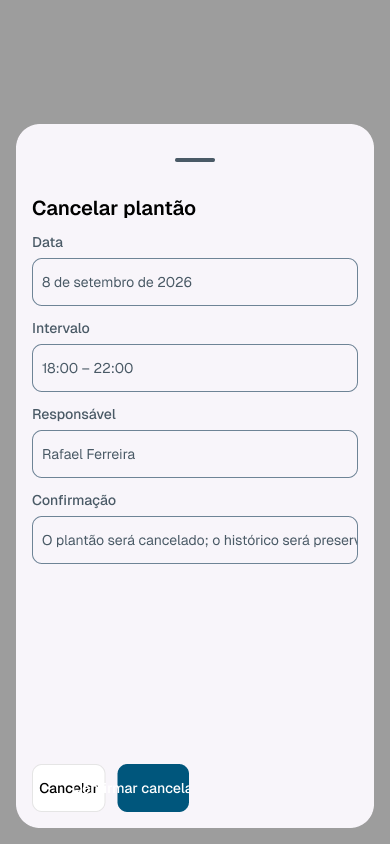
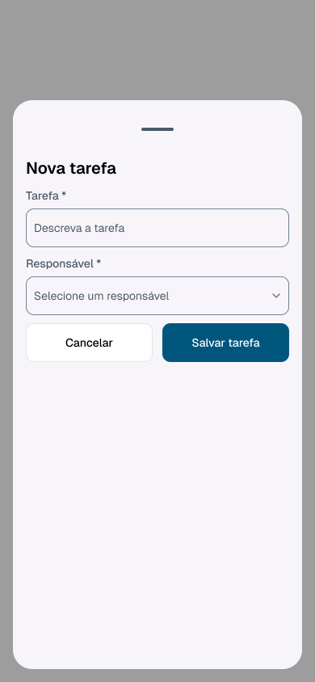
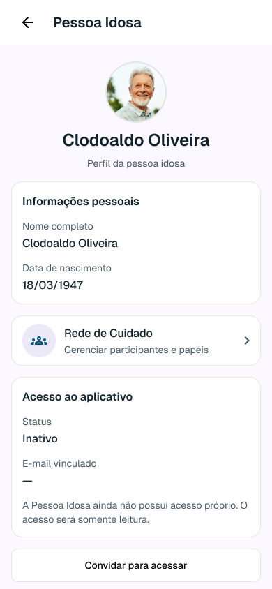
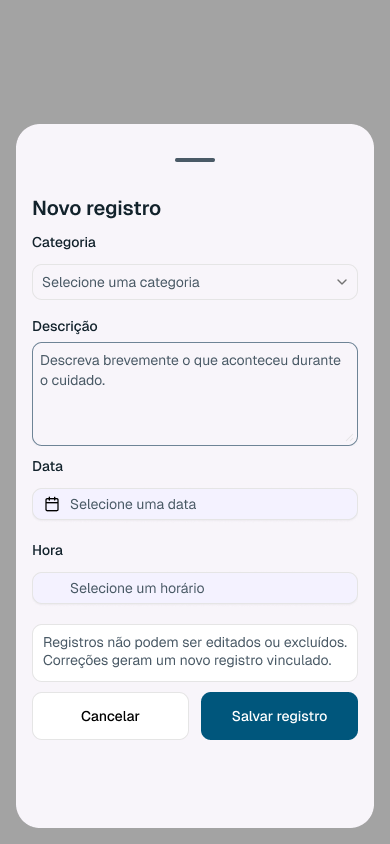
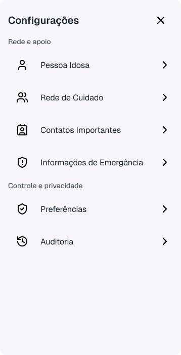
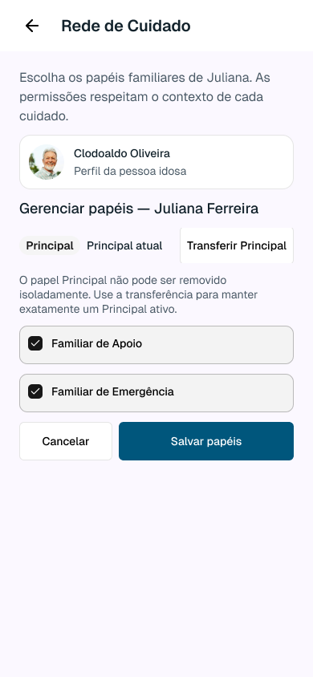
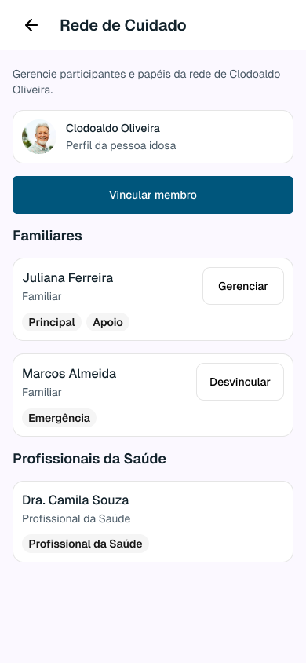
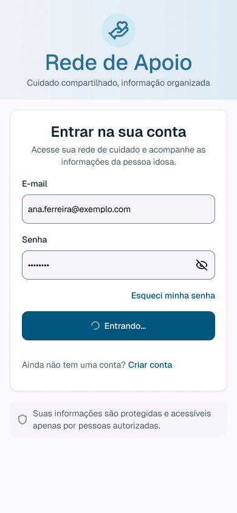
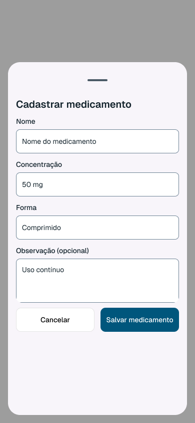

# Galeria — capturas reais do Figma

PNG nativos obtidos nesta rodada, sem retoque, anotações raster ou montagem de telas. Os destaques são textuais. Os hashes, método e Node IDs estão no índice JSON. Painéis isolados estão identificados como tal e não simulam a tela-base em Presentation.

## Comparações dos achados

### VIS-001 — Grupo de ações estreito corta rótulos de operações críticas

Olhar o rodapé do overlay, aproximadamente x=32–189, y=764–812 no frame 390×844: dois botões ficam concentrados em metade da linha, com textos cortados. No Sheet de referência a linha de ações usa toda a largura útil.

| Evidência do problema | Referência comparativa |
|---|---|
|  |  |

Outras capturas do caso: [T08_administration_A](capturas/T08_administration_A.png), [T13_constitution](capturas/T13_constitution.png).
[Medidas e recomendação](ACHADOS_VIS.md#vis-001).

### VIS-002 — Mensagem de confirmação de cancelamento fica truncada

Olhar o campo Confirmação, em torno de y=518–566. A frase termina visualmente antes do final do conteúdo registrado nas propriedades.

| Evidência do problema | Referência comparativa |
|---|---|
|  |  |

[Medidas e recomendação](ACHADOS_VIS.md#vis-002).

### VIS-003 — Estado de acesso ativo corta a última linha de orientação

Olhar o final do card Acesso ao aplicativo, em torno de y=714–770. A terceira linha alcança a borda do card; comparar a mensagem de duas linhas do estado inativo.

| Evidência do problema | Referência comparativa |
|---|---|
|  |  |

[Medidas e recomendação](ACHADOS_VIS.md#vis-003).

### VIS-004 — Contornos de campos ainda usam borda decorativa de baixo contraste

Comparar os contornos muito claros de Categoria/Data/Hora e dos inputs do contato com o contorno de E-mail/Senha do Login. O contraste foi calculado sobre as cores resolvidas, não sobre antialiasing do texto.

| Evidência do problema | Referência comparativa |
|---|---|
|  |  |

Outras capturas do caso: [T14_edit_Carlos](capturas/T14_edit_Carlos.png).
[Medidas e recomendação](ACHADOS_VIS.md#vis-004).

### VIS-005 — Destinos do perfil são desenhados como cards manuais

Comparar as duas caixas de destino abaixo de Informações pessoais com as Rows do Settings da Foundation: as primeiras ganham border/fill/radius de card.

| Evidência do problema | Referência comparativa |
|---|---|
|  |  |

Outras capturas do caso: [T12_access_active](capturas/T12_access_active.png).
[Medidas e recomendação](ACHADOS_VIS.md#vis-005).

### VIS-006 — Gerenciar papéis troca o grid externo de 16 por 24 px

Comparar as bordas externas da introdução, contexto e botões: 24 px no estado de papéis versus 16 px na base da Rede.

| Evidência do problema | Referência comparativa |
|---|---|
|  |  |

[Medidas e recomendação](ACHADOS_VIS.md#vis-006).

### VIS-007 — Link auxiliar muda de nome durante Loading do Login

Comparar o link abaixo do botão principal: Criar conta no Loading versus Usar convite no default. O spinner não está desalinhado.

| Evidência do problema | Referência comparativa |
|---|---|
|  |  |

[Medidas e recomendação](ACHADOS_VIS.md#vis-007).

### VIS-008 — Scrim operacional está mais opaco que a referência aprovada

O overlay de medicamento usa scrim de cerca de 36%. A prova quantitativa é o alpha dos exports isolados; o Settings é referência de hierarquia, não comparação pixel a pixel sobre o mesmo fundo.

| Evidência do problema | Referência comparativa |
|---|---|
|  |  |

[Medidas e recomendação](ACHADOS_VIS.md#vis-008).

## Bases T01–T17

| Tela | Node ID | Captura nativa |
|---|---|---|
| T01 | [`6223:6272`](https://www.figma.com/design/ljFSoPfNcvDgZtdR2sHmti?node-id=6223-6272) | [captura](capturas/T01_default.png) |
| T02 | [`6223:6301`](https://www.figma.com/design/ljFSoPfNcvDgZtdR2sHmti?node-id=6223-6301) | [captura](capturas/T02_default.png) |
| T03 | [`6223:6338`](https://www.figma.com/design/ljFSoPfNcvDgZtdR2sHmti?node-id=6223-6338) | [captura](capturas/T03_default.png) |
| T04 | [`6223:6364`](https://www.figma.com/design/ljFSoPfNcvDgZtdR2sHmti?node-id=6223-6364) | [captura](capturas/T04_week.png) |
| T05 | [`6223:6495`](https://www.figma.com/design/ljFSoPfNcvDgZtdR2sHmti?node-id=6223-6495) | [captura](capturas/T05_default.png) |
| T06 | [`6223:6562`](https://www.figma.com/design/ljFSoPfNcvDgZtdR2sHmti?node-id=6223-6562) | [captura](capturas/T06_default.png) |
| T07 | [`6223:6581`](https://www.figma.com/design/ljFSoPfNcvDgZtdR2sHmti?node-id=6223-6581) | [captura](capturas/T07_default.png) |
| T08 | [`6223:6593`](https://www.figma.com/design/ljFSoPfNcvDgZtdR2sHmti?node-id=6223-6593) | [captura](capturas/T08_default.png) |
| T09 | [`6223:6630`](https://www.figma.com/design/ljFSoPfNcvDgZtdR2sHmti?node-id=6223-6630) | [captura](capturas/T09_default.png) |
| T10 | [`6223:6663`](https://www.figma.com/design/ljFSoPfNcvDgZtdR2sHmti?node-id=6223-6663) | [captura](capturas/T10_default.png) |
| T11 | [`6223:6682`](https://www.figma.com/design/ljFSoPfNcvDgZtdR2sHmti?node-id=6223-6682) | [captura](capturas/T11_default.png) |
| T12 | [`6223:6704`](https://www.figma.com/design/ljFSoPfNcvDgZtdR2sHmti?node-id=6223-6704) | [captura](capturas/T12_default.png) |
| T13 | [`6223:6738`](https://www.figma.com/design/ljFSoPfNcvDgZtdR2sHmti?node-id=6223-6738) | [captura](capturas/T13_default.png) |
| T14 | [`6223:6773`](https://www.figma.com/design/ljFSoPfNcvDgZtdR2sHmti?node-id=6223-6773) | [captura](capturas/T14_default.png) |
| T15 | [`6223:6788`](https://www.figma.com/design/ljFSoPfNcvDgZtdR2sHmti?node-id=6223-6788) | [captura](capturas/T15_default_context.png) |
| T16 | [`6223:6800`](https://www.figma.com/design/ljFSoPfNcvDgZtdR2sHmti?node-id=6223-6800) | [captura](capturas/T16_default.png) |
| T17 | [`6223:6836`](https://www.figma.com/design/ljFSoPfNcvDgZtdR2sHmti?node-id=6223-6836) | [captura](capturas/T17_default_context.png) |

## Estados, overlays e referências adicionais

| Captura | Node ID do render | Dimensões PNG | Tipo |
|---|---|---|---|
| [N04_feedback](capturas/N04_feedback.png) | [`6223:8798`](https://www.figma.com/design/ljFSoPfNcvDgZtdR2sHmti?node-id=6223-8798) | 390×844 | state_or_overlay |
| [REF_ButtonStates](capturas/REF_ButtonStates.png) | [`5641:155`](https://www.figma.com/design/ljFSoPfNcvDgZtdR2sHmti?node-id=5641-155) | 1024×133 | reference |
| [REF_FieldTarget](capturas/REF_FieldTarget.png) | [`5644:330`](https://www.figma.com/design/ljFSoPfNcvDgZtdR2sHmti?node-id=5644-330) | 358×48 | reference |
| [REF_HeaderBack](capturas/REF_HeaderBack.png) | [`5640:21512`](https://www.figma.com/design/ljFSoPfNcvDgZtdR2sHmti?node-id=5640-21512) | 390×64 | reference |
| [REF_NavigationBar](capturas/REF_NavigationBar.png) | [`6223:6681`](https://www.figma.com/design/ljFSoPfNcvDgZtdR2sHmti?node-id=6223-6681) | 390×80 | reference |
| [REF_Scrim](capturas/REF_Scrim.png) | [`5652:625`](https://www.figma.com/design/ljFSoPfNcvDgZtdR2sHmti?node-id=5652-625) | 390×700 | reference |
| [REF_Settings](capturas/REF_Settings.png) | [`5652:443`](https://www.figma.com/design/ljFSoPfNcvDgZtdR2sHmti?node-id=5652-443) | 358×700 | reference |
| [RO_T04_week](capturas/RO_T04_week.png) | [`6223:9223`](https://www.figma.com/design/ljFSoPfNcvDgZtdR2sHmti?node-id=6223-9223) | 390×844 | state_or_overlay |
| [RO_T06_diary](capturas/RO_T06_diary.png) | [`6223:9516`](https://www.figma.com/design/ljFSoPfNcvDgZtdR2sHmti?node-id=6223-9516) | 390×844 | state_or_overlay |
| [Settings_work](capturas/Settings_work.png) | [`6223:8965`](https://www.figma.com/design/ljFSoPfNcvDgZtdR2sHmti?node-id=6223-8965) | 358×700 | state_or_overlay |
| [T01_invalid](capturas/T01_invalid.png) | [`6223:6863`](https://www.figma.com/design/ljFSoPfNcvDgZtdR2sHmti?node-id=6223-6863) | 390×844 | state_or_overlay |
| [T01_loading](capturas/T01_loading.png) | [`6223:6894`](https://www.figma.com/design/ljFSoPfNcvDgZtdR2sHmti?node-id=6223-6894) | 390×844 | state_or_overlay |
| [T02_confirmed](capturas/T02_confirmed.png) | [`8009:11294`](https://www.figma.com/design/ljFSoPfNcvDgZtdR2sHmti?node-id=8009-11294) | 390×844 | state_or_overlay |
| [T02_validation](capturas/T02_validation.png) | [`6223:6923`](https://www.figma.com/design/ljFSoPfNcvDgZtdR2sHmti?node-id=6223-6923) | 390×844 | state_or_overlay |
| [T04_shift_cancel](capturas/T04_shift_cancel.png) | [`8016:14055`](https://www.figma.com/design/ljFSoPfNcvDgZtdR2sHmti?node-id=8016-14055) | 390×844 | state_or_overlay |
| [T04_shift_create](capturas/T04_shift_create.png) | [`8016:13861`](https://www.figma.com/design/ljFSoPfNcvDgZtdR2sHmti?node-id=8016-13861) | 390×844 | state_or_overlay |
| [T04_shift_response](capturas/T04_shift_response.png) | [`8016:15427`](https://www.figma.com/design/ljFSoPfNcvDgZtdR2sHmti?node-id=8016-15427) | 390×844 | state_or_overlay |
| [T06_sheet](capturas/T06_sheet.png) | [`6223:9141`](https://www.figma.com/design/ljFSoPfNcvDgZtdR2sHmti?node-id=6223-9141) | 390×844 | state_or_overlay |
| [T06_sheet_error](capturas/T06_sheet_error.png) | [`6223:9168`](https://www.figma.com/design/ljFSoPfNcvDgZtdR2sHmti?node-id=6223-9168) | 390×844 | state_or_overlay |
| [T07_version](capturas/T07_version.png) | [`8012:14929`](https://www.figma.com/design/ljFSoPfNcvDgZtdR2sHmti?node-id=8012-14929) | 390×844 | state_or_overlay |
| [T08_administration_A](capturas/T08_administration_A.png) | [`8017:14668`](https://www.figma.com/design/ljFSoPfNcvDgZtdR2sHmti?node-id=8017-14668) | 390×844 | state_or_overlay |
| [T08_empty](capturas/T08_empty.png) | [`6223:7512`](https://www.figma.com/design/ljFSoPfNcvDgZtdR2sHmti?node-id=6223-7512) | 390×844 | state_or_overlay |
| [T08_posology_A](capturas/T08_posology_A.png) | [`8017:14551`](https://www.figma.com/design/ljFSoPfNcvDgZtdR2sHmti?node-id=8017-14551) | 390×844 | state_or_overlay |
| [T08_sheet_context](capturas/T08_sheet_context.png) | [`6223:8966`](https://www.figma.com/design/ljFSoPfNcvDgZtdR2sHmti?node-id=6223-8966) | 390×844 | state_or_overlay |
| [T08_sheet_error_panel](capturas/T08_sheet_error_panel.png) | [`6223:8994`](https://www.figma.com/design/ljFSoPfNcvDgZtdR2sHmti?node-id=6223-8994) | 358×704 | state_or_overlay |
| [T09_complete](capturas/T09_complete.png) | [`8005:10762`](https://www.figma.com/design/ljFSoPfNcvDgZtdR2sHmti?node-id=8005-10762) | 390×844 | state_or_overlay |
| [T09_sheet_error_panel](capturas/T09_sheet_error_panel.png) | [`6223:9036`](https://www.figma.com/design/ljFSoPfNcvDgZtdR2sHmti?node-id=6223-9036) | 358×704 | state_or_overlay |
| [T09_sheet_verified](capturas/T09_sheet_verified.png) | [`6223:9019`](https://www.figma.com/design/ljFSoPfNcvDgZtdR2sHmti?node-id=6223-9019) | 390×844 | state_or_overlay |
| [T10_attachment_panel](capturas/T10_attachment_panel.png) | [`6223:9088`](https://www.figma.com/design/ljFSoPfNcvDgZtdR2sHmti?node-id=6223-9088) | 358×704 | state_or_overlay |
| [T10_empty](capturas/T10_empty.png) | [`6223:7828`](https://www.figma.com/design/ljFSoPfNcvDgZtdR2sHmti?node-id=6223-7828) | 390×844 | state_or_overlay |
| [T10_sheet](capturas/T10_sheet.png) | [`6223:9051`](https://www.figma.com/design/ljFSoPfNcvDgZtdR2sHmti?node-id=6223-9051) | 390×844 | state_or_overlay |
| [T10_sheet_error](capturas/T10_sheet_error.png) | [`6223:9068`](https://www.figma.com/design/ljFSoPfNcvDgZtdR2sHmti?node-id=6223-9068) | 390×844 | state_or_overlay |
| [T11_sheet_error_panel](capturas/T11_sheet_error_panel.png) | [`6223:9122`](https://www.figma.com/design/ljFSoPfNcvDgZtdR2sHmti?node-id=6223-9122) | 358×704 | state_or_overlay |
| [T11_sheet_verified](capturas/T11_sheet_verified.png) | [`6223:9102`](https://www.figma.com/design/ljFSoPfNcvDgZtdR2sHmti?node-id=6223-9102) | 390×844 | state_or_overlay |
| [T12_access_active](capturas/T12_access_active.png) | [`6223:8895`](https://www.figma.com/design/ljFSoPfNcvDgZtdR2sHmti?node-id=6223-8895) | 390×844 | state_or_overlay |
| [T12_access_not_configured](capturas/T12_access_not_configured.png) | [`6223:8825`](https://www.figma.com/design/ljFSoPfNcvDgZtdR2sHmti?node-id=6223-8825) | 390×844 | state_or_overlay |
| [T12_invitation_sent](capturas/T12_invitation_sent.png) | [`6223:8860`](https://www.figma.com/design/ljFSoPfNcvDgZtdR2sHmti?node-id=6223-8860) | 390×844 | state_or_overlay |
| [T13_constitution](capturas/T13_constitution.png) | [`8018:15830`](https://www.figma.com/design/ljFSoPfNcvDgZtdR2sHmti?node-id=8018-15830) | 390×844 | state_or_overlay |
| [T13_roles](capturas/T13_roles.png) | [`8010:12352`](https://www.figma.com/design/ljFSoPfNcvDgZtdR2sHmti?node-id=8010-12352) | 390×844 | state_or_overlay |
| [T14_edit_Carlos](capturas/T14_edit_Carlos.png) | [`8006:33693`](https://www.figma.com/design/ljFSoPfNcvDgZtdR2sHmti?node-id=8006-33693) | 390×844 | state_or_overlay |
| [T14_updated_Carlos](capturas/T14_updated_Carlos.png) | [`8006:33819`](https://www.figma.com/design/ljFSoPfNcvDgZtdR2sHmti?node-id=8006-33819) | 390×844 | state_or_overlay |
| [T16_optional](capturas/T16_optional.png) | [`8010:12439`](https://www.figma.com/design/ljFSoPfNcvDgZtdR2sHmti?node-id=8010-12439) | 390×844 | state_or_overlay |
| [T16_saved](capturas/T16_saved.png) | [`8010:12650`](https://www.figma.com/design/ljFSoPfNcvDgZtdR2sHmti?node-id=8010-12650) | 390×844 | state_or_overlay |
| [T17_detail](capturas/T17_detail.png) | [`8011:11419`](https://www.figma.com/design/ljFSoPfNcvDgZtdR2sHmti?node-id=8011-11419) | 390×844 | state_or_overlay |
| [T17_forbidden](capturas/T17_forbidden.png) | [`8009:11459`](https://www.figma.com/design/ljFSoPfNcvDgZtdR2sHmti?node-id=8009-11459) | 390×844 | state_or_overlay |
| [WORK_Scrim_T08](capturas/WORK_Scrim_T08.png) | [`6223:8967`](https://www.figma.com/design/ljFSoPfNcvDgZtdR2sHmti?node-id=6223-8967) | 390×844 | reference |

## Limitações de exportação

As primeiras capturas de T15/T17 e alguns overlays omitiram decoração/ícones. Os renders alternativos e a leitura das propriedades impediram falsos achados de ausência de Back, avatar, shape ou handle. Capturas com omissões não foram usadas para afirmar defeito nesses elementos. Em alguns estados, mesmo o painel isolado não oferece evidência suficiente do handle; essa parcela permanece não verificável, sem inventar uma falha do produto.

No diagnóstico foram usados apenas cortes de texto, geometria, cor e composição confirmados por mais de uma evidência (render + metadata/contexto/variável). A inspeção das partes disponíveis de um estado não certifica sua composição integral ou comportamento.
