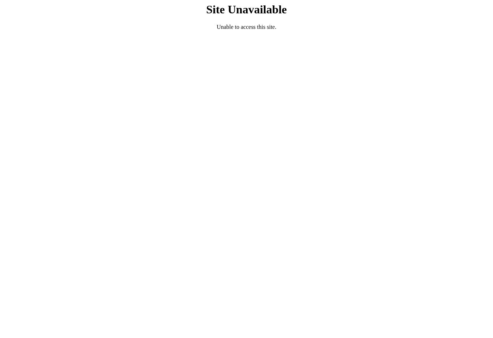

# LOTE 07 — parecer de homologação integrada

**Parecer: NÃO APROVADO. Homologação interativa bloqueada por indisponibilidade de acesso no navegador desta sessão.**

Rodada de 16/10/2026, America/Manaus. Evidência capturada às **07:42:53 −04:00** / **11:42:53 UTC**. Relatório gerado em `2026-10-16T07:49:31.963684-04:00`. Fonte documental atualizada: PR [#127](https://github.com/webkauadev/rede-de-apoio/pull/127), branch `docs/figma-plano-correcao-20261015`, commit `9762ac719cdd04eca802521f6a452ecaf61ffdab`. As evidências estáticas das correções permanecem atribuídas a `925b19e20b1fa851107cf1b12c0442287fc6350e`.

O registro [LOTE_07_RETOMADA_2026-10-16.md](../LOTE_07_RETOMADA_2026-10-16.md), já presente no commit anterior, foi preservado. Ele documenta uma tentativa distinta com recarga. Este complemento acrescenta o roteiro assistido e resultados por cenário/AUD; a contagem de uma abertura sem recarga abaixo se refere somente à tentativa observada nesta execução.

## Resultado da tentativa

Foi feita uma abertura do Presentation da cópia `ljFSoPfNcvDgZtdR2sHmti`, a partir de T01 `6223:6272`, página `6223:6270`. O navegador mostrou **Site Unavailable — Unable to access this site** antes de carregar qualquer tela do aplicativo. Conforme a missão, nenhuma recarga ou nova tentativa foi feita. A causa técnica não foi determinada; a captura não prova indisponibilidade geral do Figma, defeito do produto ou bloqueio por bot.

[Registro textual, URL exata e SHA-256](evidencias/EV07-ENV-001.txt). A evidência comprova somente a limitação de acesso.

## Contagens de cenários

| Resultado interativo | Quantidade |
|---|---:|
| APROVADO | 0 |
| REPROVADO por defeito observado no produto | 0 |
| NÃO VERIFICÁVEL | 39 |
| Cenários do produto efetivamente executados | 0 |

O roteiro contém 26 cenários com prioridade de execução P1 e 13 P2, incluindo verificações de texto ligadas ao AUD P3. São os **39 itens operacionais do checklist anterior**; não há contagem artificial de variantes como testes realizados. Os três gates CH-40–42 são registrados à parte. Zero reprovados não significa ausência de defeitos: não houve execução observável do produto.

## Status final dos 28 AUDs nesta rodada

As correções anteriores permanecem registradas como aplicadas. Esta rodada não as reabriu nem as homologou por interação. Os 11 P1, 16 P2 e 1 P3 conservam as gravidades da auditoria; não surgiu defeito reproduzível novo.

| AUD | Gravidade original | Evidência anterior, não reexecutada | Testes preparados | Homologação interativa L07 |
|---|---|---|---|---|
| AUD-001 | P1 | Configuração conferida; runtime pendente | H07-001, H07-002, H07-003 | NÃO VERIFICÁVEL |
| AUD-002 | P1 | Configuração conferida; runtime pendente | H07-016, H07-017, H07-018 | NÃO VERIFICÁVEL |
| AUD-003 | P1 | Configuração conferida; runtime pendente | H07-019, H07-020 | NÃO VERIFICÁVEL |
| AUD-004 | P1 | Configuração conferida; runtime pendente | H07-007, H07-008 | NÃO VERIFICÁVEL |
| AUD-005 | P1 | Configuração conferida; runtime pendente | H07-005, H07-009, H07-010, H07-011, H07-013, H07-014, H07-015, H07-029, H07-031, H07-039 | NÃO VERIFICÁVEL |
| AUD-006 | P1 | Configuração conferida; runtime pendente | H07-021 | NÃO VERIFICÁVEL |
| AUD-007 | P1 | Configuração conferida; runtime pendente | H07-023 | NÃO VERIFICÁVEL |
| AUD-008 | P1 | Configuração conferida; runtime pendente | H07-024 | NÃO VERIFICÁVEL |
| AUD-009 | P1 | Configuração conferida; runtime pendente | H07-025 | NÃO VERIFICÁVEL |
| AUD-010 | P1 | Configuração conferida; runtime pendente | H07-018, H07-026 | NÃO VERIFICÁVEL |
| AUD-011 | P1 | Configuração conferida; runtime pendente | H07-027 | NÃO VERIFICÁVEL |
| AUD-012 | P2 | Configuração conferida; runtime pendente | H07-001, H07-003, H07-004, H07-005, H07-006 | NÃO VERIFICÁVEL |
| AUD-013 | P2 | Configuração conferida; runtime pendente | H07-033, H07-034, H07-038 | NÃO VERIFICÁVEL |
| AUD-014 | P2 | Configuração conferida; runtime pendente | H07-005, H07-022 | NÃO VERIFICÁVEL |
| AUD-015 | P2 | Propriedades/dados/composição conferidos anteriormente | H07-031, H07-035, H07-039 | NÃO VERIFICÁVEL |
| AUD-016 | P2 | Propriedades/dados/composição conferidos anteriormente | H07-037 | NÃO VERIFICÁVEL |
| AUD-017 | P2 | Propriedades/dados/composição conferidos anteriormente | H07-030, H07-032 | NÃO VERIFICÁVEL |
| AUD-018 | P2 | Propriedades/dados/composição conferidos anteriormente | H07-036, H07-038 | NÃO VERIFICÁVEL |
| AUD-019 | P2 | Propriedades/dados/composição conferidos anteriormente | H07-037 | NÃO VERIFICÁVEL |
| AUD-020 | P2 | Propriedades/dados/composição conferidos anteriormente | H07-037 | NÃO VERIFICÁVEL |
| AUD-021 | P2 | Propriedades/dados/composição conferidos anteriormente | H07-037 | NÃO VERIFICÁVEL |
| AUD-022 | P2 | Propriedades/dados/composição conferidos anteriormente | H07-012, H07-035, H07-039 | NÃO VERIFICÁVEL |
| AUD-023 | P2 | Propriedades/dados/composição conferidos anteriormente | H07-037 | NÃO VERIFICÁVEL |
| AUD-024 | P2 | Propriedades/dados/composição conferidos anteriormente | H07-028, H07-032 | NÃO VERIFICÁVEL |
| AUD-025 | P2 | Propriedades/dados/composição conferidos anteriormente | H07-028, H07-029 | NÃO VERIFICÁVEL |
| AUD-026 | P2 | Propriedades/dados/composição conferidos anteriormente | H07-029, H07-030 | NÃO VERIFICÁVEL |
| AUD-027 | P3 | Propriedades/dados/composição conferidos anteriormente | H07-006 | NÃO VERIFICÁVEL |
| AUD-028 | P2 | Propriedades/dados/composição conferidos anteriormente | H07-021, H07-028 | NÃO VERIFICÁVEL |

A tabela separa estado da correção e estado de homologação. O histórico original permanece em [STATUS_28_ACHADOS.json](../STATUS_28_ACHADOS.json); a consolidação desta rodada e os campos de execução estão em [RESULTADOS.json](RESULTADOS.json).

## Continuação assistida preparada

[ROTEIRO_ASSISTIDO.md](ROTEIRO_ASSISTIDO.md) contém a ordem P1 → P2, ator/fixture, Node IDs de partida, ações planejadas, resultados esperados e variantes por registro, tarefa, contato, medicamento, papel e preferência. Cada variante tem campos de resultado/evidência próprios. As ações executadas começam vazias; o erro de acesso não foi reutilizado como evidência de teste do produto.

Começar localmente por H07-001 (Login), H07-002/003 (convite), H07-004/006 (leitura e negação), H07-007/008 (cadastro da Pessoa Idosa) e seguir os demais P1 da tabela. Abertura direta de um frame de resultado serve apenas à preparação do cenário; a aprovação exige a transição de origem ao destino e seu retorno.

## Pendências e limites

- Execução local observável dos 39 cenários e das variantes aplicáveis, com capturas/vídeos de produto. Cliques, gestos, scroll, timeouts e retornos continuam não verificados.
- P1 pendentes impedem homologação integral e também aprovação com ressalvas nesta rodada. O gate CH-40 não está satisfeito; CH-42 aguarda revisão humana. CH-41 foi documentado e não é teste funcional.
- Propriedades, medidas, grafo e capturas de `925b19e` são evidências estáticas anteriores. Não houve nova auditoria estrutural ou repetição dos lotes 00–06. FI-008 é metadado, separado da regressão por clique.
- Não foi validado backend, autenticação real, persistência, entrega de notificações, geração real de CSV, concorrência, foco/teclado ou leitor de tela. Recolhimento da LocalSubnav e gesto não disponível são limites de simulação a registrar especificamente.

## Alterações e preservação

Esta rodada criou somente documentação e a evidência do bloqueio na branch existente do PR #127. **Nenhuma chamada de escrita foi enviada ao Figma**, à página de trabalho, à baseline interna `5926:1014` ou ao original externo `tcyj2fkTXei2CJbqaRxqCp`. Não foi criada nova cópia, alterado requisito/permissão, modificado registry canônico, promovido protótipo, feito merge ou retirado o Draft.

Não houve correção adicional porque nenhum defeito do produto foi reproduzido nesta rodada. O PR #127 deve continuar Draft. A etapa documental de contingência está concluída; **o LOTE 07 permanece bloqueado para homologação funcional**, aguardando execução assistida.
