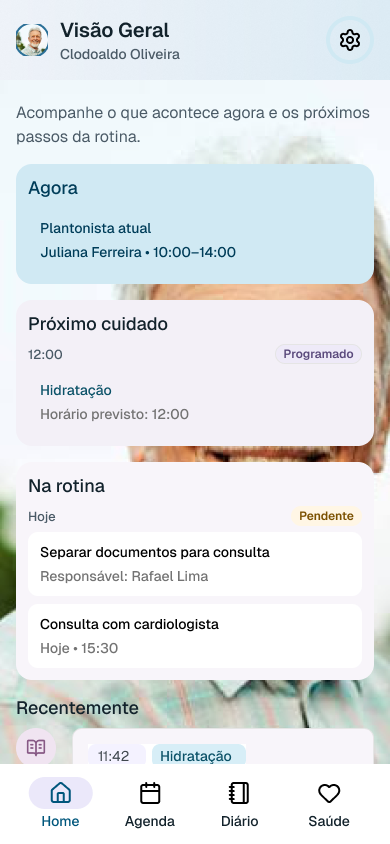
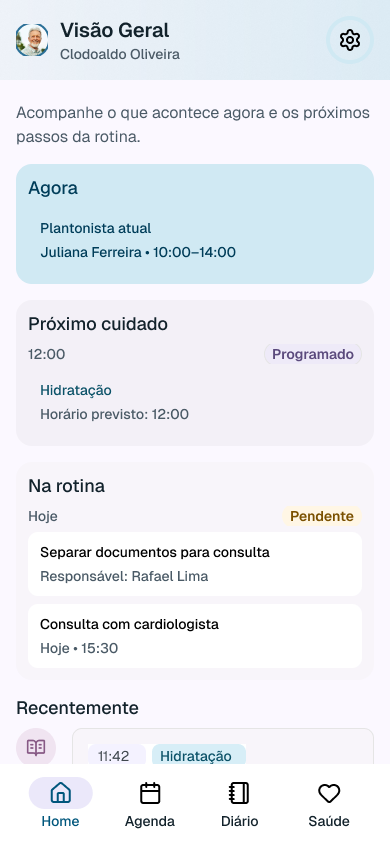
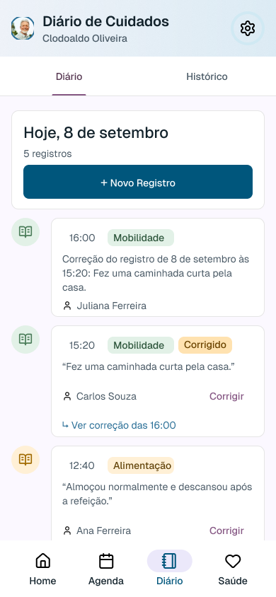
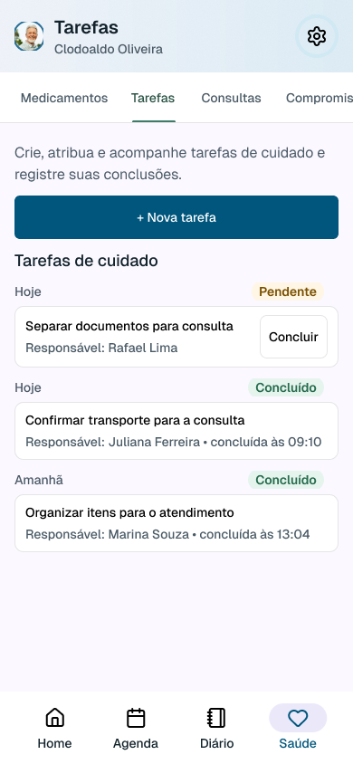
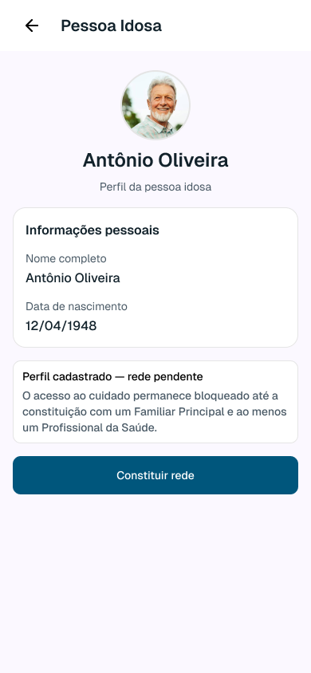

# Evidências visuais da execução

Capturas isoladas obtidas do conector Figma. São imagens de evidência; as telas no Figma continuam editáveis. Nenhuma imagem foi usada para reconstruir a interface.

| Evidência | Arquivo |
|---|---|
| T03-antes-auditoria | [T03-antes-auditoria.png](T03-antes-auditoria.png) |
| T03-home | [T03-home.png](T03-home.png) |
| T04-agenda-pos | [T04-agenda-pos.png](T04-agenda-pos.png) |
| T04-gerenciar-sheet-pos | [T04-gerenciar-sheet-pos.png](T04-gerenciar-sheet-pos.png) |
| T06-correcao-resultado | [T06-correcao-resultado.png](T06-correcao-resultado.png) |
| T06-inclusao-pos | [T06-inclusao-pos.png](T06-inclusao-pos.png) |
| T07-correcao | [T07-correcao.png](T07-correcao.png) |
| T08-inclusao | [T08-inclusao.png](T08-inclusao.png) |
| T08-plano | [T08-plano.png](T08-plano.png) |
| T09-conclusao-organizar-pos | [T09-conclusao-organizar-pos.png](T09-conclusao-organizar-pos.png) |
| T10-inclusao | [T10-inclusao.png](T10-inclusao.png) |
| T11-sheet-preenchido | [T11-sheet-preenchido.png](T11-sheet-preenchido.png) |
| T12-pendente-pos | [T12-pendente-pos.png](T12-pendente-pos.png) |
| T13-papeis-final | [T13-papeis-final.png](T13-papeis-final.png) |
| T13-transferencia | [T13-transferencia.png](T13-transferencia.png) |
| T16-salvo-pos | [T16-salvo-pos.png](T16-salvo-pos.png) |

## Comparação do fundo da Home

| Auditoria anterior | Cópia corrigida |
|---|---|
|  |  |

## Resultados representativos

